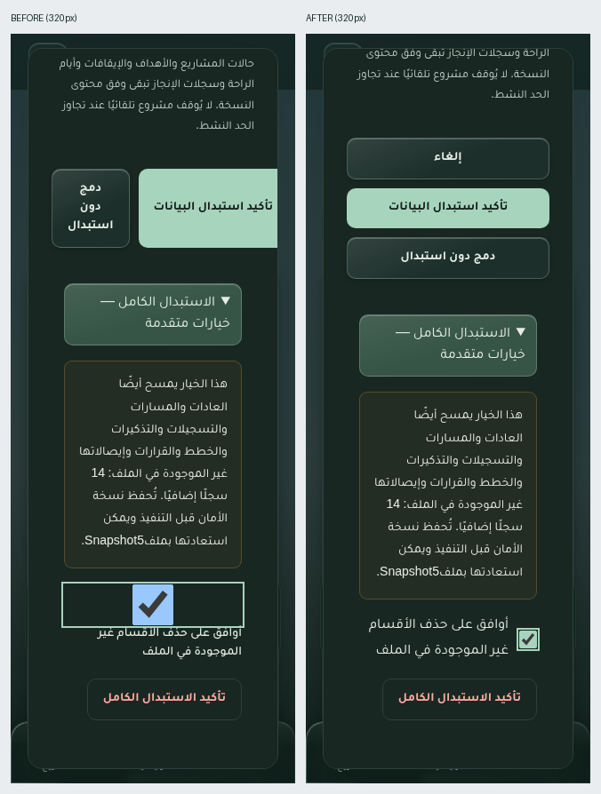
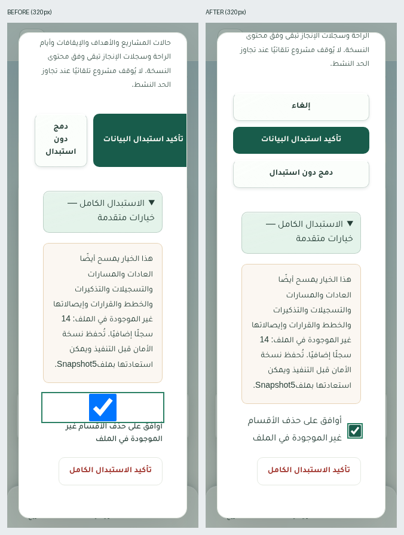

# مسار — تقرير المرحلة الثانية: التخزين والترحيل والنسخ الاحتياطية

**النطاق:** تأسيس schema7 وSnapshot5 والتحقق والتصدير والاستعادة والدمج فقط. احتُفظ بتنقل المرحلة الأولى وبوابة المشاريع واختصار المهام وLiving Sky وLiquid Glass. لا تنفيذ للمرحلة الثالثة أو تسجيل عادات أو إنشاء تذكيرات أو تغذية. لا بيانات افتراضية أو توليد تاريخ قديم.

العمل محلي، فوق Commit `8d03d7401e8452f629db895b827bcf295557fcc4` وتغييرات المرحلة الأولى غير المدفوعة. لم تتغير الحزم أو رقم التطبيق1.4.3 أوManifest. **لم يحدثCommit جديد أوPush أو نشر، ولم تُستخدم بيانات المستخدم الفعلية.**

## التنفيذ الفعلي

1. بقيت قاعدة`masar-v1` باسمها وجداولها الاثني عشر. الترقية منDexie6 إلى7 تضيف سبعة مخازن فارغة؛ إصدارIndexedDB الأصلي60→70. لا callback ترحيل جديد ولا إعادة كتابة صفوف أو تغيير فهارس قديمة.
2. أضيفت عقود المسارات والعادات والمراجعات والمستويات والقياسات والقرارات والتذكيرات والإيصالات، مع قيود العلاقات والتواريخ المحلية وDST والدقة العددية وثبات وحدة المرحلة. الفهارس الفريدة تمنع تكرار مراجعة الخطة أو تسجيل العادة في اليوم نفسه، بما يشمل اتصالين.
3. تصديرSnapshot5 يشمل الجداول التسعة عشر. تُقبل النسخ1–4 المدعومة، ولا تقرأ الرئيسية أو`useAppData` سجلات العادات كاملة.
4. الاستعادة الافتراضية للنسخ1–4 تحفظ الأقسام السبعة غير الموجودة فيها حرفيًا. الاستبدال الكامل منفصل، مع وصف الأثر وعدد السجلات ومربع موافقة وتأكيد مستقل. نسخة5 تصرح بجميع المصفوفات؛ الفارغة تعني استعادة قسم فارغ، كما توضح المعاينة.
5. قبل أي مسح للاستعادة، تحفظ نسخةSnapshot5 متحققة في قاعدة محلية مستقلة`masar-v1-recovery`. تنتظر الخدمة التزام النسخة قبل المسح وتستعيد الجداول الرئيسية في معاملة واحدة. فشل المساحة أو الحفظ أو التحقق يمنع المسح؛ فشل لاحق يعيد جميع الجداول الرئيسية إلى ما كانت عليه.
6. زر لتنزيل نسخة الأمان الأخيرة، مع بصمة سلامة وفحص حد20MiB قبل إنشاء نسخة قد تتجاوز حد الاستيراد. النسخة مستقلة عن الجداول التي يستبدلها المستخدم.
7. الدمج ذري وإضافي، ويعيد ربط المعرفات على مستوى نوع الجدول، ومفاتيح المراحل داخل الخطط والتسجيلات والمقترحات. لا يستبدل إيصالًا محليًا فعالًا، ويحتفظ بقرارات القبول والرفض التاريخية، ويعلم المقترحات الواردة غير المعتمدة بأنها غير صالحة دون تنفيذها.
8. البصمة الجديدة تشمل البيانات الجديدة، وتثبت أمام إعادة ترتيب مفاتيحJSON وصفوف الجداول وتغييرexportedAt. تُحترم البصمات السابقة، ويتحقق الإيصال الجديد من وجود عناصره فعليًا بدل منع الاستيراد بعد حذفها.
9. تحديثPWA ينتظر كتابات الاستعادة والدمج المعلقة. لم يُغيّر استيراد`masar.project` الإصدار1.

التفاصيل الملزمة ونموذجSnapshot5 وسياسة الاستعادة في [عقد البيانات](HABITS_PHASE2_DATA_SPEC.md).

## الملفات الرئيسية

| الملفات | الدور |
|---|---|
|`app/db.ts`|schema7، القراءة الكاملة، الاستعادة الآمنة، المعاينة بالأعداد، الدمج والذرية|
|`app/model.ts`|Snapshot5 وربط التحقق الجديد|
|`app/habitTypes.ts` و`app/habitValidation.ts`|العقود والتحقق من العلاقات والخطط واللقطات والقيم|
|`app/backupTables.ts`|أسماء الجداول وحد الملف والنطاقات المشتركة|
|`app/habitBackupMerge.ts`|إعادة ربط الرسم والمرحلة والإيصال والتحقق من وجود النتائج|
|`app/backupRecovery.ts`|نسخ الأمان المستقلة والتجزئة والتحقق والتنزيل|
|`app/backupWrites.ts`|انتظار الكتابات قبل تحديثPWA|
|`app/BackupRestore.tsx` و`app/backupRestore.css`|معاينة الأثر والاستبدال الكامل والتأكيد، ضمن الهوية الحالية|
|`app/App.tsx`|ربط المعاينة والتنزيل وانتظارPWA وتنظيف نوايا اليوم بعد الاستعادة|
|`app/paceValidation.ts`|التحقق من كون بصمات الدمج القديمة مصفوفة نصوص دون رفض النصوص القديمة المدعومة|
|`tests/habitFixtures.ts`،`tests/habitValidation.test.ts`،`tests/habitStorage.test.ts`|بيانات معزولة واختبارات الوحدة والتكامل|
|`tests/browser/habits-phase2.spec.ts`|رحلات الاستعادة والدمج والفشل وRTL والثيمين والجوال|
|اختبارات الانحدار الحالية|تحديث توقع رقم النسخة والمخطط فقط، مع استمرار قياس حفظ السجلات والوظائف القديمة|

## نتائج الاختبارات

|الفحص|النتيجة النهائية|الدليل|
|---|---|---|
|الوحدة والتكامل|**484 ناجح، 0 فاشل، 0 متخطى** في32 مجموعة؛ منها98 جديدة:69 للتحقق و29 للتخزين|[نتيجة الآلة](docs/habits-phase2/unit-results.json)|
|المتصفح الشامل|**258 ناجح، 0 فاشل، 0 متخطى**؛243 قائمة و15 جديدة، على البناء قبل الإصلاح النهائي لنوايا اليوم وتنسيق المعاينة|[النتيجة](docs/habits-phase2/browser-results.json)|
|إعادة الفحص على البناء النهائي|**40 ناجح، 0 فاشل، 0 متخطى**:16 للمرحلة الثانية،12 لتنقل المرحلة الأولى،12 لتجربة مهامي اليوم|[النتيجة](docs/habits-phase2/browser-final-recheck.json)|
|إعادة فحص اللقطات النهائية|**4 ناجح، 0 فاشل، 0 متخطى**:الفاتح والداكن بعرض320 و390، والأزرار ومربع الموافقة داخل حدود الشاشة|[النتيجة](docs/habits-phase2/browser-layout-final.json)|
|ترقيةPWA وحفظ البيانات|**22 مجموعة تحقق ناجحة**، دون أخطاءConsole مسجلة؛ تحقق أصلي واحد لحفظ ملف بعد إعادة الفتح دون اتصال تعذّر بسبب Chromium|[النتيجة والحدود](docs/habits-phase2/pwa-result.json)|
|TypeScript|ناجح مستقلًا، وضمن بناء الإنتاج|[السجل](docs/habits-phase2/typecheck.log)|
|Lint المعتمد بالمشروع:Oxlint|ناجح؛ لا سكربتESLint منفصل في المشروع|[السجل](docs/habits-phase2/lint.log)|
|تنسيق الملفات الجديدة|ناجح بعد تصحيح تنسيق اختبار فقط|[السجل](docs/habits-phase2/format-check.log)|
|بناء الإنتاج النهائي|ناجح، مع تحذير حجم الحزمة المعروف، دون مكتبات جديدة|[البناء الأساسي](docs/habits-phase2/build.log) و[بناء مسار النشر الحالي محليًا](docs/habits-phase2/production-build.log)|

إجمالي حالات المتصفح الفريدة التي نجحت **259**؛ منها16 جديدة. لا نجمع إعادة الفحوص مع المرور الشامل على أنها حالات مختلفة. لم يُنفذ مرور شامل واحد من259 على النسخة النهائية؛ نُفّذ المرور الشامل258 ثم أعيدت المجموعات المتأثرة40 وبعدها حالات العرض الأربع. لم تُحذف أو تُعطّل حالات فاشلة، ولا تُحسب تجربة تنزيل الملف المتعذرة نجاحًا.

### الترحيل وسلامة السجلات

أنشأ اختبار الترقية المعزول قاعدة6 بفهرسة1.4.3 ومحتوى غير فارغ في **كل الجداول الاثني عشر**: مشاريع وخطوات ومهام مستقلة ومتكررة ودورات وأفكار وأحداث وتقدم وتتبع وأهداف وإيقافات وعمل خطوات وقرارات وإعدادات راحة. قورنت الصفوف والفهارس قبل وبعد، بما فيها حقل قديم إضافي غير معروف، ثم أعيد فتح القاعدة دون توليد تاريخ جديد.

واختبر سيناريوPWA البناء المنشور1.4.3 نفسه داخل ملفChromium مؤقت، ثم حدّثService Worker إلى المرشح المحلي. بقيت الصفوف الاثنا عشر مطابقة، وانتقل الإصدار60→70 وظهرت الجداول السبعة فارغة. أُدخلت بياناتSnapshot5 اختبارية، ثم استعادت نسخة4 الأقسام القديمة مع حفظ الأقسام الجديدة. أُغلق المتصفح كاملًا وأعيد فتحه دون اتصال: استمرت بيانات الجداول التسعة عشر والثيم والضبابية والتنقل الجديد ونسخة الأمان.

### الذرية والتعارض

- رفض ملف غير صالح قبل أي كتابة أو نسخة أمان.
- فشلQuota عند حفظ نسخة الأمان يمنع المسح.
- فشلIndexedDB أثناء إدراج التذكيرات يتراجع عن الجداول التسعة عشر، مع بقاء نسخة الأمان المستقلة.
- فشل في منتصف الدمج يتراجع عن الرسم والبصمات والإيصالات معًا.
- استعادة نسخة1–4 افتراضيًا لا تمس العادات والتذكيرات؛ الاستبدال الكامل دون موافقة يرفض؛ نسخته الاحتياطية تستعيد كل المحذوف.
- تغير الأعداد بعد المعاينة يمنع الاستبدال حتى إعادة المراجعة.
- اتصالان يرفضان تسجيلين للعادة واليوم نفسه أو مراجعتين برقم واحد؛ وملفان متزامنان يندمجان مرة واحدة.
- معرف متطابق في نوعين لا يخلط المسار والعادة؛ إيصال وارد لا يكتب فوق المحلي؛ الإيصال ذو النتائج الغائبة لا يمنع إعادة الاستيراد.
- اختباراتversionchange وblocked تنتظر إغلاق الاتصال القديم، دون حذف القاعدة أو إعادة إنشائها.

## المشكلات المكتشفة والمعالجة

|المشكلة|الخطورة|السبب والإصلاح|الإثبات|
|---|---|---|---|
|مسح الأقسام الجديدة عند استعادة ملف قديم|عالية|المسار السابق يمسح`db.tables` كلها. أصبحت الجداول المستهدفة مرتبطة بنوع النسخة والوضع المؤكد|أربع نسخ قديمة، ومقارنة الأقسام السبعة قبل/بعد، عبر الوحدة والمتصفح|
|عدم وجود نسخة أمان ملزمة قبل الاستبدال|عالية|أضيف حاجز نسخة مستقلة ملتزمة ومتحققة، قبل أولclear، مع رفض الفشل والحجم غير القابل للاستيراد|حقنQuota وفشل إدراج لاحق واستعادة نسخة الأمان|
|نية يوم قديمة تغير مهمة مستعادة بعد إعادة الفتح|متوسطة|المسار السابق ينظف المسودات والإنجازات المعلقة، لكنه يترك`masar-pending-today/`. أضيف تنظيفها بعد نجاح الاستعادة فقط|[إعادة الإنتاج الأصلية](docs/habits-phase2/pending-intent-before.json)، و[نتيجة الإصلاح الفعلية](docs/habits-phase2/pending-intent-result.json)، واختبار انحدار ناجح على البناء النهائي|
|قص أزرار المعاينة ومربع موافقة متضخم320px|متوسطة|ثلاثة أزرار لا تلتف، ومربعcheckbox يرث تنسيق حقول النص. أضيفت أنماط محصورة في المعاينة|صور قبل/بعد وفحص عرض محتوىDialog وحجمcheckbox وAxe|
|بصمة لا تشمل البيانات الجديدة أو لا تثبت أمام إعادة تنسيقJSON|متوسطة|أضيفت تجزئة حتمية وإيصال يثبت وجود النتائج، مع استمرار احترام البصمة القديمة|دمج متزامن، وإعادة ترتيب المفاتيح والسجلات، وتغيير تسجيل واحد|
|رفض قيم نصية قديمة غير قياسية للبصمات|توافق|ضُبط التحقق على النوع الفعلي القديمstring[]، دون فرضSHA على البيانات التاريخية|اختبار نسخة قديمة تحتوي علامات نصية مكررة|

عولجت كذلك أخطاء في أدوات الاختبار الأولية: موضع تهيئةfake-indexeddb، واستخدام فعل إنجاز المهمة بدل الدورة في إعداد بيانات الترحيل، وحقن الفشل في كائن جدول لا تستخدمه المعاملة، ومقارنة ترتيب ملفJSON بترتيب المفتاح فيIndexedDB. صُححت أدوات الإعداد والحقن، دون تعطيل اختبارات أو تغيير منطق المهام لتجاوز إخفاق.

## حدود التحقق ومخاطر باقية

1. **حفظ الملف الأصلي بعد إعادة فتح Chromium دون اتصال:** المتصفح النظامي154 يتعطل بـSIGTRAP/SIGSEGV عند تنزيلBlob بعد إعادة فتح ملف مستخدم سبق أن نزّل ملفًا. أُعيد العطل في صفحة فارغة بملف`{"control":true}`، دون مسار أوIndexedDB. حفظ الملف نجح قبل إغلاق المتصفح، واستعادة نسخة الأمان وقراءة محتواها وتوليدBlob الصحيح نجحت بعد إعادة الفتح دون اتصال. لا نساوي توليدBlob بنجاح الحفظ على القرص؛ الأخير لم يمكن إثباته في هذه البيئة. فشلت محاولة تنزيل المتصفح المطابق لـPlaywright برسالة403`Domain forbidden`. يلزم اختبار الحفظ بعد إعادة الفتح علىAndroid حقيقي أو متصفح سليم قبل اعتماد نشر لاحق.
2. لا يوجد هاتفAndroid حقيقي في البيئة. اختبارات اللمس والمقاسات وRTL والثيمات عبرChromium فعلي؛ لا تثبت لون شريط نظامAndroid أو سلوكWebAPK المثبت.
3. نسخ الأمان محلية على الجهاز نفسه، ولا تحمي من مسح بيانات الموقع. لا تُحذف نقاطها آليًا؛ قد تستهلك مساحة وتمنع استعادة لاحقة عند امتلائها، بأمان ودون حذف البيانات. يُنصح بالتصدير إلى ملف خارجي قبل أي نشر لاحق.
4. تجاوز نسخة الأمان المنسقة20MiB يمنع الاستعادة بدل حذف بيانات لا تقبل الواجهة ملف استعادتها. لم يُرفع حد الملفات أو يُخفَّ تجاوز المساحة.
5. لا يمكن إعادة اشتقاق بصمة موحدة من بصمة قديمة أحادية الاتجاه وحدها لملف أعيد تنسيقه بعد التحديث. منع تكرار الملفات السابقة الدقيقة محفوظ؛ الملفات الجديدة لها بصمة حتمية.
6. لا downgrade آلي إلىschema6 بعد الترقية؛ يلزم إصلاح أمامي ونسخة محفوظة. لم يُختبرWebKit أوFirefox في هذه المرحلة.
7. نماذج العادات وتسجيلها وحساب الالتزام والتطور والاستيراد المستقل والتذكيرات المرئية مؤجلة لمراحلها. لا توجد تلك الوظائف هنا كي ندعي اختبارها.

أدلة التشغيل والفشل المستقل للمتصفح في`docs/habits-phase2/`، ومنها [اختبار التحكم](docs/habits-phase2/chromium-download-control.log) و[سجل الانهيار](docs/habits-phase2/debug-offline-explicit.log) و[فحوصPWA والبيانات](docs/habits-phase2/pwa-result.json).

## الصور وحفظ أعمال المرحلة الأولى

لقطات أصلية منChromium، ببيانات اختبار فقط. صور المقارنة تجمع اللقطتين دون تعديل محتواهما. تغير موضع التمرير بينهما لإظهار زر الاستبدال الكامل داخل الشاشة الصغيرة:

صور منفردة: [فاتح390](docs/habits-phase2/restore-preview-light-390.png)، [داكن390](docs/habits-phase2/restore-preview-dark-390.png)، [فاتح320](docs/habits-phase2/restore-preview-light-320.png)، [داكن320](docs/habits-phase2/restore-preview-dark-320.png).

فُصلت مخرجات الانحدار الجديدة في`docs/habits-phase2/regression/` وأعيد231 ملف أدلة تاريخي متتبع إلى محتواه السابق. بقي تقرير المرحلة الأولى وصورها الأصلية قبل التعديل وصور المقارنة محفوظة. تجددت12 لقطة «بعد» للمرحلة الأولى عند تشغيل الاختبارات الفعلية؛ لم تُدّعَ مطابقتها بكسليًا للأصل. ملفات تنقل المرحلة الأولى وملفات نظام المهام والمشاريع والسماء غير المستهدفة تطابق بصمات بداية هذه المرحلة. [سجل أرشفة الأدلة](docs/habits-phase2/regression-artifacts.json).

## القرار

**المرحلة الثانية مكتملة محليًا وجاهزة للمراجعة، مع حد تحقق معلن لتنزيل ملف دون اتصال بعد إعادة تشغيل المتصفح.** لا يُوصى بادعاء اكتمال تحققAndroid أو اعتماد نشر اعتمادًا على هذه المحاكاة وحدها. لا يحتاج الترحيل لإدخال بيانات افتراضية، ولم يجر أي وصول إلى بيانات المستخدم الفعلية.

**لم يحدثCommit جديد أو نشر أوPush، ولم تبدأ المرحلة الثالثة.**
