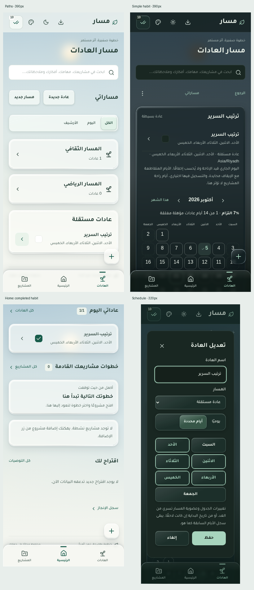

# مسار — تقرير المرحلة الثالثة: المسارات والعادات البسيطة

**الحالة: المرحلة الثالثة مكتملة محليًا وجاهزة للمراجعة التقنية. لا نشر؛ شرط تجربة تنزيل النسخة علىAndroid حقيقي باقٍ.**

بُني العمل على التعديلات المحلية المعتمدة للمرحلتين1 و2 فوقCommit `8d03d7401e8452f629db895b827bcf295557fcc4`، وليس نسخة أقدم منهما. لم يحدثCommit جديد أوPush أو نشر. لم تُستخدم بيانات المستخدم الفعلية؛ جميع التجارب في قواعد أو ملفات متصفح معزولة.

**شرط النشر المسجل:** تنزيل نسخة احتياطية وفتحها للتحقق على هاتفAndroid حقيقي، بما في ذلك بعد إغلاق التطبيق وإعادة فتحه دون اتصال. لم يُنفذ هذا الشرط هنا، ولا تعني الموافقة التقنية على هذه المرحلة الموافقة على النشر.

## 1. المنفذ فعليًا

- صفحة «مساراتي» داخل تبويب العادات الحالي، مع عرض الكل واليوم والأرشيف، وروابط تفاصيل مستقلة تحت `#habit-path/id` و`#habit/id`.
- إنشاء المسار وتعديله وأرشفته واستعادته، وإنشاء عادة بسيطة داخل مسار أو مستقلة افتراضيًا. لا مسارات أو عادات افتراضية.
- إنشاء وتعديل عادة بعنوان وجدول يومي أو أيام أسبوع محددة وتاريخ بداية اليوم أو لاحقًا؛ تُلتقط منطقة الجهاز الزمنية عند الإنشاء وتبقى ثابتة.
- نقل العادة إلى مسار أو بين مسارين أو فصلها، دون تغيير معرفها أو حذف تاريخها. تنشأ مراجعة خطة ثابتة عند تغيير الجدول أو العضوية، ويسري التغيير غدًا أو في تاريخ البداية إن كانت لاحقة.
- إنجاز اليوم والتراجع بنقرة، مع حفظ الحالة المطلوبة صراحةً بدل تبديل قيمة مقروءة قديمة. التصحيح التاريخي يعدل الصف نفسه ويحفظ وقت إدخاله الأصلي ووقت التعديل الحقيقي.
- إيقاف عادة أو مسار واستئنافه، مع حفظ فتراتUTC. الإيقافات المتداخلة لا تُخصم مرتين، واستئناف المسار لا يستأنف عادة أوقفها المستخدم بصورة مستقلة.
- تفاصيل العادة: تسجيل اليوم، الخطة السارية والتغيير القادم، تقويم شهري مبسط وسجل التسجيلات وتعديل يوم سابق. لا شاشة مستويات كمية أو تطور للعادات المتدرجة.
- حساب الالتزام من الأيام المستهدفة المؤهلة المغلقة فقط. تفاصيل المسار تجمع «أيام عادات» وفق العضوية التاريخية.
- بطاقة «عاداتي اليوم» بعد مهامي اليوم وقبل متابعة المشاريع؛ تعرض المنجز/المستهدف وأول3 عادات، وتتيح الإنجاز والتراجع والوصول إلى الجميع. تبقى العادة المكتملة متاحة للتراجع، دون خلطها مع المهام.
- زرالإضافة العائم الحالي يحافظ على موضعه ووظائفه؛ يضيف عادة من الرئيسية، ويقدم عادة ومسارًا في قسم العادات، مع بقاء الإضافات القديمة.
- Living Sky وLiquid Glass وRTL والثيمان والحركات والتنقل الثلاثي واختصار المهام والروابط القديمة محفوظة.

## 2. قواعد الأيام والسجل

**الالتزام = الأيام المغلقة التي حققت العادة ÷ الأيام المستهدفة المؤهلة المغلقة.** يعرض نقص البيانات بدل نسبة100٪ عند غياب المقام. اليوم الجاري لا يزيد البسط أو المقام قبل انتهائه، حتى لو أُنجز؛ يظهر إنجازه في بطاقة اليوم مباشرةً.

الحساب يستخدم حدود اليوم الفعلية في توقيت العادة بواسطةTemporal؛ اليوم قد يكون23 أو25 ساعة. الأيام الأسبوعية0=الأحد إلى6=السبت، والعرض يبدأ بالسبت. لا تحويل تلقائي للسجلات عند سفر المستخدم أو تغيير توقيت الجهاز.

أي يوم يتقاطع مع إيقاف العادة أو المسار الساري في **خطة ذلك اليوم** محايد، بما فيه الاستئناف الجزئي. الاستئناف عند منتصف الليل يسمح لليوم الكامل التالي بالاحتساب. التسجيل أثناء الإيقاف أو في يوم غير مستهدف محفوظ كنشاط اختياري، ولا يدخل بسط الالتزام أو مقامه. أيام راحة المشاريع لا تُقرأ هنا ولا تؤثر في العادات.

تُختار أعلى مراجعة سارية لليوم، بما يشمل تعديلات متعددة معتمدة للغد. نقل العادة إلى مسار موقوف اعتبارًا من الغد لا يلغي مطالبة اليوم وفق عضويتها القديمة. يُرفض تسجيل المستقبل أو ما قبل البداية، والرجوع بساعة الجهاز قبل آخر حفظ لا يُنتج تواريخ بيانات غير صالحة.

لا تُنشأ سجلات تلقائية لعدم الإنجاز أو الانقطاع. إلغاء الإنجاز يحفظ نتيجة `done:false` في الصف اليومي نفسه؛ لا حذف لتعريف العادة، ولا نسخ يومية أو سجلات مهام جديدة. الفهرس الفريد `[habitId+localDate]` والمعاملة يحميان اليوم من التكرار حتى عبر نافذتين.

## 3. الأرشفة والعضوية

استُخدم عقد البيانات المعتمد كما هو: `habitPaths.deletedAt` علامة حفظ للمسار المؤرشف، ولا يُسمح لعضوية حالية أن تشير إلى مسار بهذه العلامة. لذلك توضح معاينة الأرشفة قبل التأكيد أن العادات تصبح مستقلة، وتبقى الخطط والسجلات التاريخية مرتبطة بالمسار السابق. هذا ليس حذفًا للعادات أو تسجيلاتها.

الأرشفة تفتح فترة إيقاف محفوظة وتخفي المطالبة، والتغييرات في العضوية التاريخية تسري غدًا. استعادة المسار لا تعيد ربط عاداته أو تستأنفها تلقائيًا. استعادة العادة نفسها لا تغلق إيقافها تلقائيًا؛ الاستئناف قرار مستقل ظاهر. لا حذف نهائي للبيانات ضمن هذه المرحلة.

## 4. الملفات والبيانات

| الملف | التغيير |
|---|---|
|`app/habitCalendar.ts`|دوال التاريخ المحلي وحدود اليوم والخطة الفعالة والحياد والالتزام واليوم|
|`app/habitStore.ts`|خدمات ذرية للإنشاء والتعديل والمراجعات والتسجيل والإيقاف والأرشفة|
|`app/useHabitData.ts`|استعلام مستقل يقرأ تعريفات العادات والخطط وسجلات الفترة المحددة واليوم؛ لا تحميل لأرشيف الإنجاز كاملًا في الرئيسية|
|`app/Habits.tsx`|صفحات المسارات والعادات والنماذج والتسجيل والسجل والتقويم وبطاقة الرئيسية|
|`app/habits.css`|أنماط محصورة ضمن الهوية الحالية وأهداف لمس44px|
|`app/App.tsx`|ربط وجهات العادات والنماذج بخياراتالإضافة الحالية|
|`app/HomeExecution.tsx`|إدراج بطاقة العادات بين المهام والمشاريع دون تغيير منطق أي منهما|
|`app/PeriodDashboard.tsx` و`app/AchievementLog.tsx`|تصحيح تباين نص التحميل المكتشف أثناء الانحدار؛ استخدام لون النص الأصلي الموروث بدل اللون الخافت فقط|
|`app/db.ts`|انتظار الكتابات المعلقة قبل التصدير العام؛ لا تغيير في المخطط|
|`tests/habitCalendar.test.ts` و`tests/habitRecording.test.ts`|56 حالة وحدة وتكامل جديدة|
|`tests/browser/habits-phase3.spec.ts`|23 رحلة متصفح جديدة، تتضمن8 حالات للمقاسات والثيمين|
|`tests/browser/living-glass.spec.ts` و`tests/browser/project-pace.spec.ts`|تكييف تحقق الهندسة والترتيب مع بطاقة العادات المعتمدة، دون تغيير المرجع التاريخي أو تعطيل الاختبار|
|`tests/browser/habits-phase2.spec.ts`|تحديث تحقق صفحة العادات من العنصر التمهيدي إلى عنوان الصفحة الفعلية؛ اختبار انعدام البيانات الافتراضية باقٍ|
|`HABITS_ARCHITECTURE_PLAN.md`|تسجيل تفويض المرحلة الثالثة مع إبقاء سجل التفويضات السابقة|

لا إصدارDexie جديد: **schema7 / IndexedDB70** باقٍ. لا حقول جديدة، ولا فهارس أو جداول إضافية، ولا تعديل لعقود المرحلة الثانية أو التحقق الصارم منها. Snapshot5 والاستعادة المحافظة1–4 والاستبدال الكامل ونسخ الأمان والدمج كما اعتُمدت. الكتابات الجديدة تدخل حاجز الكتابة المستخدم للتصدير وتحديثPWA.

الجداول القديمة الاثنا عشر لا تستخدمها خدمات العادات. لا أحداث عادات داخل`events` أو`tasks` أو`taskCycles`، ولا تغير لإحصاءات المهام أو المشاريع. لم تتغير الحزم أوManifest أوهوية التطبيق أوstart_url أوscope أو رقم1.4.3؛ هذه نسخة محلية غير منشورة.

## 5. الاختبارات والنتائج

| المستوى | النتيجة | الإثبات |
|---|---|---|
|الوحدة والتكامل|**540 ناجح،0 فاشل،0 متخطى**؛484 قائمة و56 جديدة|[JSON](docs/habits-phase3/unit-results.json) و[السجل](docs/habits-phase3/unit.log)|
|المتصفح الخاص بالمرحلة|**23 حالة فريدة ناجحة**؛22 ضمن إعادة الفحص واختبار تحميل معلق إضافي|[JSON للبناء الأخير](docs/habits-phase3/browser-final-recheck.json)|
|المتصفح الشامل|**277 ناجح،3 إخفاقات،0 متخطى** في المرور الأول؛ حُلّت الإخفاقات وأعيدت ضمن المجموعة التالية|[السجل](docs/habits-phase3/browser-run.log)|
|إعادة الاختبارات المتأثرة بالمرور الشامل|**33 ناجح،0 فاشل،0 متخطى**؛ الزجاج المشترك وLiving Sky ووتيرة المشاريع، وتشمل الإخفاقات الثلاثة السابقة|[النتيجة](docs/habits-phase3/browser-regressions-final.json)|
|اختبار تحميل فعلي معلق|**1 ناجح**؛ تباين نظرة عامة وسجل الإنجاز مع حجز قراءةIndexedDB اختباريًا|[النتيجة](docs/habits-phase3/browser-loading-final.json) و[قياس البكسلات](docs/habits-phase3/loading-contrast.json)|
|إعادة الفحص النهائية|**62 ناجح،0 فاشل،0 متخطى**؛22 للعادات و16 للنسخ و12 للتنقل و12 لمهامي اليوم|[النتيجة](docs/habits-phase3/browser-final-recheck.json)|
|تحديثPWA والتخزين|**12 مجموعة ناجحة** على البناء الأخير؛ دون أخطاءConsole غير معالجة|[النتيجة](docs/habits-phase3/pwa-result.json)|
|TypeScript وLint|ناجحان؛Linter المعتمد هوOxlint، ولا يوجد سكربتESLint منفصل|[TypeScript](docs/habits-phase3/typecheck.log) و[Lint](docs/habits-phase3/lint.log)|
|بناء الإنتاج|ناجح للجذر ولمسار الموقع الحالي محليًا، مع تحذير حجم الحزمة المعروف|[البناء](docs/habits-phase3/build.log) و[بناءPWA](docs/habits-phase3/production-build.log)|

**الحصيلة:540 وحدة وتكامل، و282 حالة متصفح فريدة اجتازت التحقق عبر المرور الشامل والإعادات، و12 مجموعةPWA. لا اختبار فاشل متبقٍ بعد الإصلاح.** وردت23 حالة متصفح جديدة فوق259 قائمة. لا نضيف تكرار الاختبارات إلى عدد الحالات الفريدة.

بدأ المرور الشامل ذو280 حالة قبل إصلاح حفظ حالة قوائم العادات عند الرجوع ونسخdifficulty التاريخية. أعيدت62 حالة متأثرة على بناء مستقل، ثم33 حالة لملفات الزجاج والوتيرة والتباين، وأضيف اختبار تحميل معلق واحد. **لا ندّعي تشغيلًا شاملًا واحدًا ناجحًا من282 حالة على البناء النهائي**، ولا نعد اختبارAndroid غير المنفذ ناجحًا أو متخطى آليًا. السجلات الأولى الفاشلة محفوظة لأغراض التدقيق.

### ما اختُبر بالفعل

- التواريخ المحلية وحدود منتصف الليل والأسبوع والأشهر والسنة والكبيسة وDST، واليوم المفتوح والمستقبل وما قبل البداية.
- الجدول اليومي والأسبوعي غير الفارغ؛ رفض التكرارات والأيام غير الصحيحة والتواريخ المستحيلة دون كتابة جزئية.
- إيقاف المسار والعادة المتداخل والاستئناف الجزئي ومنتصف الليل والتسجيل الاختياري، وعدم إلغاء الإيقاف المستقل.
- الإتمام والتراجع والتعديل السابق وثبات المعرف ووقت الإدخال؛20 طلبًا متزامنًا في التكامل، ونافذتان فعليتان في المتصفح مع حاجزIndexedDB **اختباري فقط** لضمان وصول الطلبين قبل الالتزام.
- النقر المتكرر10 مرات على التحكم نفسه، دون تسجيلين لليوم.
- نقل العضوية وفصلها ومراجعات الغد والسريان بعد بداية مستقبلية، مع التحقق عبر عقدSnapshot5.
- فشل إدراج خطة بعد إنشاء العادة يعيد المعاملة كاملة؛ فشل الأرشفة يحفظ البيانات؛ ضبط الساعة للخلف لا يكتب بيانات غير صالحة.
- تصدير واستعادة ودمج بيانات أنشأتها خدمات المرحلة نفسها، ومنع إعادة الدمج، ومقارنة بيانات المهام والمشاريع والأفكار بعد تسجيل عادة.
- Chromium فعلي بعروض320/390/768/1366، والثيمين وRTL، وفتح النماذج والقوائم وEscape والرجوع والروابط المباشرة، وفحوصAxe للنموذج، وغياب التمرير الأفقي وأهداف لمس44px.
- ترقيةService Worker من بناء المرحلة الثانية إلى هذه المرحلة، ومطابقة الجداول التسعة عشر قبل وبعد، وبقاءDB70 وManifest نفسه، ووجود ملفات الإصدار الحالي فقط في cache.
- إغلاق Chromium كاملًا وإعادة فتح ملفه المعزول دون اتصال، ثم التراجع من الرئيسية وإعادة الإنجاز من التفاصيل والتنقل للصفحات القديمة، مع حفظ السجلات دون تضاعف.

## 6. المشكلات المعالجة والأداء

| المشكلة | السبب | الإصلاح والإثبات |
|---|---|---|
|تأخر إظهار الإيقاف حتى دقيقة|اعتماد العرض على وقت آخرنبضة فقط، وقد يسبق توقيت الإيقاف الجديد|قراءة الوقت الحالي عند تحديث البيانات، مع بقاء النبضة وعودةالرؤية؛ نجحت رحلات الإيقاف والأرشفة والاستئناف الفوري|
|تباين عبارة تحميل سجل الإنجاز في صباح داكن320px:4.425:1 بدل4.5:1|لونmuted للنص العابر فوق السماء أضعف من المطلوب|حذف اللون الخافت من رسالتي التحميل فقط لتستخدما لون النص الأصلي. الاختبار المعلق يقيس7.828:1 و9.694:1، ومرور التباين لجميع الصفحات ناجح|
|فقد حقل اختياري قديم عند تصحيح الإنجاز|إعادة بناء صف التسجيل دون نسخ difficulty الموجودة|نسخ الحقل القديم دون جمعه أو عرضه كميزة جديدة؛ اختبار وحدة وتحقق متصفح عند تصحيح اليوم السابق|
|فقد Escape أثناء قراءة نموذج جديد|تبديلDialog التحميل إلىDialog آخر يلغي حركة الإغلاق قبل استدعاء الإغلاق النهائي|Dialog واحد ثابت، وقراءة النموذج داخله، وقفل الحفظ فقط؛ اختبارالإضافةالعائمة ثمEscape ناجح|
|فقد تحديدالأرشيف عند الانتقال إليه من عرضاليوم|حالة محلية يعاد إنشاؤها عند تغير الوجهة|`#habits/archive` قابل لإعادة الفتح، مع تحقق الانتقال وإعادة التحميل|
|احتمال عرضتسجيل خاطئ بعد اختيار يوم خارج الشهر|بيانات الشهر وحدها لا تشمل اليوم المختار أواليوم الحالي عندعرضشهر قديم|استعلام مفهرس لليوم المحدد مع ربط النتيجة بتاريخها، وضم اليوم الحالي إلى البيانات المحدودة؛ اختبارتصحيحOct5 أثناء عرضSeptember ناجح|
|الرجوع من عادة ضمن قائمة طويلة يفقد التوسيع وموضع التمرير|إعادة تركيب الصفحة قبل وصول البيانات المفهرسة يقلص ارتفاعها، ويعيد حد30|حفظ limit والشهر وموضع التمرير في ذاكرة عرض محدودة20 وجهة، ثم الاستعادة بعد اكتمال ارتفاع المحتوى؛[قبل الإصلاح](docs/habits-phase3/scroll-before.json) و[بعده](docs/habits-phase3/scroll-result.json):4133→4133px مع60 صفًا|
|مطالبة اليوم تتأثر بعضوية مسار موقوف تسريغدًا|استخدام العضوية الحالية مع عضوية خطةاليوم معًا|الالتزام والمطالبة يستخدمان المسار الساري في خطةاليوم؛ اختبار انحدار للانتقالإلىمسار موقوف|
|بطءفتح النموذج مع قائمة عاداتطويلة|عدد كبير من عناصرالخلفية عند فتحModal أصلي|عرض30 عادة ثم تحميل30 إضافية دون حذف أي عنصر؛ اختبارالوصول إلى151 صفًا وفتحالنموذج مع152 عادة وإبطاءCPU4×|

القياس الأول كان **1250ms** لفتح النموذج مع عرض151 عادة مستقلة. بعد العرض على دفعات وسلامة دورةDialog كان **414ms** في إعادة الفحص المركزة، و395ms في إعادة لاحقة، بنفس إبطاءCPU4×؛ القياس الأحدث في[performance.json](docs/habits-phase3/performance.json). هذه قراءات من محاكاةCPU على حاسوب، وليست ضمانًا لزمن جهازAndroid. لم يُستخدم تأخير اصطناعي أو شاشة انتظار لإخفاء عمل ثقيل.

فُصلت أخطاء أدوات الاختبار عن أخطاء التطبيق: ملفSnapshot5 التجريبي الأول كان ينقصه تتبع وخطط المشاريع ومصفوفات قديمة مطلوبة؛ أُصلح الملف بدل إضعاف التحقق. واختبار نافذتين دون حاجز كان يسمح أن ترى النافذة الثانية إنجاز الأولى ثم تنقر للتراجع؛ أصبح الاختبار يضمن حالتين ابتدائيتين متطابقتين. لم تُحذف اختبارات أو تُعطّل لتجاوز إخفاق. ظهر أيضًا قياس حدود عائمة43.999992px لعنصرCSS44px؛ أصبح الاختبار يقيس الحد الصارم فيCSS وoffsetWidth، ثم يطابق الرسم عند دقة جزء من مئة بكسل بعد استقرار الحركة، دون تعديل التطبيق لهذا السبب. [السجل الأول](docs/habits-phase3/browser-subpixel.log).

الإخفاقان البنيويان في المرور الشامل كانا يفترضان أن قسم المشاريع ثاني أقسام الرئيسية وأن هندسته المطلقة لم تتحرك. أصبح التحقق يثبت الأقسام الأربعة بالترتيب المعتمد ويقارن حجم البطاقات القديمة ومحتواها وهندستها الداخلية النسبية؛ لم يُعدل ملفbefore-geometry.json التاريخي ولم تُحذف المقارنة.

## 7. الصور الفعلية

الصور منChromium على بيانات معزولة ووقت متحكم به، وليست تصاميم مولدة:

- [المسارات — فاتح320](docs/habits-phase3/paths-light-320.png) و[داكن390](docs/habits-phase3/paths-dark-390.png).
- [تفاصيل المسار390](docs/habits-phase3/path-light-390.png).
- [تفاصيل العادة — داكن390](docs/habits-phase3/habit-dark-390.png) و[فاتح320](docs/habits-phase3/habit-light-320.png).
- [نموذج العادة — فاتح390](docs/habits-phase3/form-light-390.png) و[داكن320](docs/habits-phase3/form-dark-320.png).
- [الرئيسية — فاتح390](docs/habits-phase3/home-light-390.png) و[داكن390](docs/habits-phase3/home-dark-390.png).
- [PWA بعد التحديث](docs/habits-phase3/pwa-updated-390.png) و[بعد إعادة الفتح دون اتصال](docs/habits-phase3/pwa-offline-390.png).

[التقويم والسجل كاملان — داكن390](docs/habits-phase3/habit-history-full-dark-390.png) و[لقطة التقويم مع التصحيح](docs/habits-phase3/calendar-history-light-390.png) و[بطاقة الرئيسية بعد الإنجاز](docs/habits-phase3/home-recorded-light-390.png).

[تحميل النظرة العامة أثناء قراءة معلقة](docs/habits-phase3/progress-loading-overview-dark-320.png) و[تحميل سجل الإنجاز](docs/habits-phase3/progress-loading-history-dark-320.png).

توجد نظائر المقاسات768 و1366 داخل المجلد نفسه. راجعت اللقطات بصريًا، مع بقاء شروط التحقق علىAndroid مستقلة عن الصور.

## 8. الحدود والمخاطر وما لم يُنفذ

1. **لم يتوفرAndroid حقيقي. اختبار تنزيل النسخة الاحتياطية على الهاتف شرط قبل النشر**، وفق اعتماد المستخدم. لم نكرر ادعاء أن توليدBlob يثبت حفظه على القرص.
2. اختبارات المتصفح هناChromium؛ لم يُختبرWebKit أوFirefox، ولا لوحة مفاتيح الهاتف الفعلية أو لون أشرطة نظامAndroid أوWebAPK على جهاز حقيقي.
3. بيانات المستخدم تظل محلية؛ مسح بيانات الموقع يهددها، ونسخة الأمان المحلية ليست بديلًا عن ملف خارجي. بقي حد20MiB وسياسة فشل النسخة الآمن قبل الاستعادة كما اعتُمدت.
4. توقيت العادة ثابت ولا توجد واجهة لتغييره؛ هذا يحفظ اتساق الماضي عند السفر. تصحيح الماضي يحفظ وقت الإدخال، ولا يدعي معرفة الساعة الفعلية للأداء القديم.
5. أرشفة المسار تفصل عاداته الحالية كما توضح المعاينة، واستعادته لا تعيد ارتباطها تلقائيًا. لا حذف نهائي ولا رفعمستوى تلقائي.
6. لم تُنفذ العادات المتدرجة أو حسابتطورها أو توصيات العادات أو استيراد`masar.habits` أوالتذكيرات أوالتغذية أو بقية إعادة تنظيم الرئيسية الخاصة بالمراحللاحقة. لا توليد بيانات لهذه الميزات.
7. لم يتغير رقم إصدارالتطبيق؛ لا رابط منشور جديد لهذه المرحلة، ولا بدءللمرحلةالرابعة. يراجع المستخدم النتيجة قبل أي انتقال أو نشر.

## 9. حفظ العمل السابق وقرار التسليم

أُرشف251 مخرج انحدار متجدد و7 ملفات جديدة داخل`docs/habits-phase3/regression/`، وأعيدت مستندات وصور المرحلتين السابقتين إلى محتواها المطابق لبصمات بداية هذه المرحلة، بما في ذلك الملفات غير المتتبعة سابقًا. لم يحدثGit reset أو استرجاع لملفات التطبيق. [سجل الأدلة](docs/habits-phase3/regression-artifacts.json).

التغيير في قاعدة البيانات اقتصر على انتظار الكتابات قبل تصديرSnapshot؛ عكس هذه الإضافة يطابق ملف المرحلة الثانية بايتًا ببايت. مخططDexie وعقود البيانات والتحقق والنسخ والاستعادة والدمج السابقة محفوظة. تقرير المرحلة الثانية وتقرير التنقل السابق لم يتغيرا. [التحقق النهائي والبصمات](docs/habits-phase3/final-verification.json).

**جاهز لمراجعة المرحلة الثالثة محليًا. يلزم اختبارAndroid الحقيقي المحدد قبل النشر. لم يحدثCommit جديد أوPush أو نشر، ولم تبدأ المرحلة الرابعة.**
